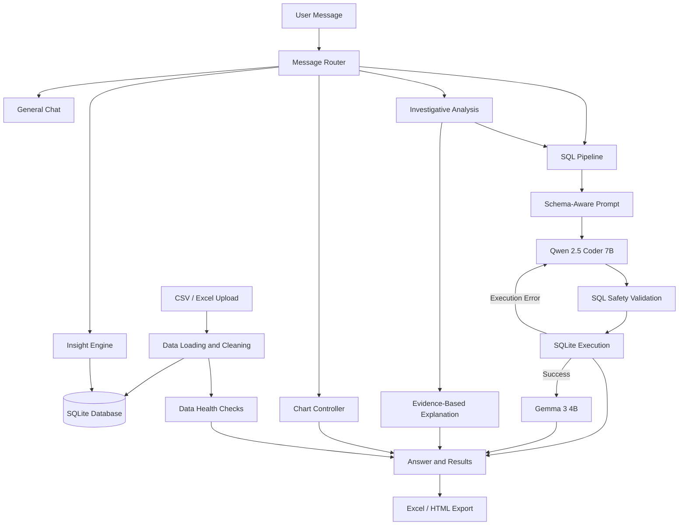

# NL2Query — Local AI Data Analyst

An interactive, local AI-powered data analyst that lets you upload CSV and Excel files, ask questions in natural language, investigate trends, discover insights, and generate charts and reports.

Powered by local open-weight models through **Ollama**, NL2Query converts natural-language questions into validated SQL, executes queries against SQLite, and explains results in plain English.

- No external LLM API keys required.
- Uploaded data is processed locally on your machine.
- SQL is validated before execution.
- Supports conversational follow-ups and multi-step investigations.
- Generates interactive visualizations and downloadable reports.

## Features

### 1. Intelligent Message Routing

A rule-based router classifies incoming messages into five categories:

- Data questions
- Insight requests
- Investigative "why" questions
- Chart requests
- General conversation

Unrecognised messages fall back to the SQL pipeline rather than being unnecessarily rejected. The router has been manually checked against 27 different phrasings, including near-matches.

### 2. Conversational Chat

- Greetings receive normal conversational responses.
- "What data do I have?" provides information about the loaded dataset.
- Ollama connection failures produce clear error messages instead of raw tracebacks.

### 3. Evidence-Based Insights

Ask questions such as:

**"What stands out in this data?"**

The application:
- Runs safe breakdown and trend queries.
- Computes findings using database results and application logic.
- Uses the LLM to phrase findings rather than invent numerical conclusions.
- Displays underlying facts so users can verify the results.

### 4. Investigative Analysis — "Why" Questions

Ask questions such as:

**"Why is Emergency higher than the other departments?"**

The application:
1. Asks the LLM to plan 2–3 investigative breakdown questions.
2. Sends each question through the validated SQL pipeline.
3. Collects query results as evidence.
4. Uses the LLM to prepare an explanation.
5. Labels explanations as hypotheses and identifies what the available data cannot establish.

Live progress updates show how the investigation is proceeding. The **How I investigated** section exposes the investigation plan and SQL queries.

### 5. Interactive Charting

- Automatically selects charts based on result structure and question context.
- Supports complementary visualizations for broader analysis questions.
- Understands requests such as "show that as a pie chart".
- Understands "no chart".
- Reuses the previous query result when changing chart presentation, without generating new SQL.
- Provides a sidebar toggle for automatic charts.
- Supports suitable chart types including bar, line, pie/donut, histogram and scatter visualizations.

### 6. Data Upload and Quality Checks

- Upload multiple CSV and Excel files.
- Each Excel worksheet becomes a separate table.
- Detects duplicate rows, missing values, unusual values, constant columns and mixed date formats.
- Identifies potential join keys across tables.
- Provides data-quality warnings and notices.

### 7. Conversational Follow-ups

Supports contextual questions such as:

- "Now split that by payer type."
- "Only Cardiology."
- "Show that as a pie chart."

Follow-up questions build on recent successful queries instead of treating every message as an unrelated request.

### 8. SQL Generation, Validation and Self-Correction

- Uses schema-aware prompts containing column information, category values, ranges and join hints.
- Supports multi-table joins.
- Allows only a single read-only SELECT statement.
- Uses SQLite read-only enforcement as an additional safety layer.
- Retries genuine SQL execution errors, feeding the error back to the model.
- Displays query attempts in the interface.
- Blocks unsafe queries instead of retrying them.

### 9. Reports and Exports

Export analysis through:

- **Excel workbooks:** Include summaries, data-health information, answer sheets and native editable charts.
- **HTML reports:** Self-contained reports that can be opened offline and printed to PDF.
- **CSV exports:** Download individual query results.

### 10. Performance Monitoring

Tracks local execution performance, including:

**Ollama**
- HTTP response time
- Model loading time
- Prompt processing time
- Generation time
- Input and output token counts
- Tokens generated per second

**SQL and application**
- SQL execution time
- Rows returned
- Process RAM before and after SQL execution
- Total successful-request execution time

These measurements help identify whether delays come from model loading, inference or database execution.

## Data Quality Improvements

Testing the application against its bundled hospital operations dataset uncovered several issues that were corrected:

| Issue | Improvement |
|---|---|
| Billing measure columns incorrectly classified as IDs | Improved ID detection so decimal cost columns are retained as measures |
| Unusual reimbursement values missed | Health checks now flag 11 additional odd reimbursement values |
| Misleading weekly growth of +379% | Partial first and last weeks are excluded from trend comparisons |
| Noisy insight findings | Ties, insignificant gaps and duplicate counts are filtered |
| Greetings incorrectly sent to SQL | Improved routing sends greetings to the chat handler |

These corrections make the analysis more reliable and reduce misleading findings.

## Architecture



## Models

| Model | Responsibility |
|---|---|
| `qwen2.5-coder:7b` | Natural-language-to-SQL generation |
| `gemma3:4b` | Result explanation and language generation |

Both models run locally through Ollama.

The application uses a 10-minute model keep-alive setting. Actual model residency and loading performance depend on available system and GPU memory.

## Hardware Requirements

The following are practical guidelines for running the configured local models. Actual performance depends on quantization, model configuration, context size and Ollama's hardware offloading.

| Component | Recommended |
|---|---|
| Operating system | Windows, macOS or Linux |
| Python | 3.10 or newer |
| RAM | 16 GB recommended |
| GPU | NVIDIA GPU with approximately 6 GB or more VRAM recommended |
| Storage | Enough free space for Ollama models, Python dependencies and datasets |
| Runtime | Ollama |

**Notes:**
- A dedicated GPU is recommended for better inference performance.
- CPU-only execution may be possible, but model responses can be considerably slower.
- Running both models efficiently depends on available RAM and VRAM.
- Larger datasets and longer prompts may require additional resources.

## Setup

### Prerequisites

- Python 3.10+
- Ollama installed and running
- Sufficient RAM and storage for the selected models

### 1. Download the models

```bash
ollama pull qwen2.5-coder:7b
ollama pull gemma3:4b
```

### 2. Clone the repository

```bash
git clone https://github.com/Harshith-G-M/Local-NL-Query.git
cd Local-NL-Query
```

### 3. Create and activate a virtual environment

**Windows PowerShell:**

```powershell
python -m venv .venv
.venv\Scripts\Activate.ps1
```

**macOS/Linux:**

```bash
python -m venv .venv
source .venv/bin/activate
```

### 4. Install dependencies

```bash
python -m pip install -r requirements.txt
```

### 5. Run the application

Ensure Ollama is running, then execute:

```bash
streamlit run app/ui.py
```

The application loads the bundled hospital operations dataset automatically when no files are uploaded.

You can also upload your own CSV or Excel files through the application. Uploaded files are used for that analysis session instead of the default sample dataset.

The bundled hospital sample data is associated with my [Hospital Ops Analytics](https://github.com/Harshith-G-M/Hospital-ops-analytics) project.

## What to Try

Try these questions to explore the application's capabilities.

**Insights**
- What stands out in this data?

**Investigative analysis**
- Why is Emergency higher than the other departments?
- Open "How I investigated" to inspect the investigation plan and SQL.

**Conversational SQL**
- How many admissions did each department have?
- Now split that by payer type.
- Show that as a pie chart.

**Business analysis**
- What is the total billing cost by department and payer type?
- What is the average length of stay by department?
- Show monthly admissions over time.

**Charting**
- Show admissions by department as a bar chart.
- Show the distribution of billing costs.
- Compare monthly admissions across departments.

**SQL safety**
- Try asking it to drop the admissions table. The validator should block the operation.

## Testing

Run the automated test suite:

```bash
python -m pytest tests/ -q
```

**Latest verified result: 48 tests passed.**

The tests cover SQL validation, read-only enforcement, file uploads, date parsing, chart selection, self-correction, follow-up prompts, join detection, data-health checks and report generation.

LLM calls are mocked, so the automated tests do not require Ollama to generate responses.

## Project Structure

```text
nl2query/
├── app/
│   ├── engine.py        # Data loading, SQL generation, validation and execution
│   ├── data_health.py   # Data quality checks and suggested questions
│   ├── charts.py        # Chart selection and Plotly visualizations
│   ├── report.py        # Excel and HTML report generation
│   └── ui.py            # Streamlit interface and message handling
├── data/                # Bundled hospital sample datasets
├── tests/
│   ├── test_features.py
│   └── test_nl2query.py
├── .gitignore
├── README.md
└── requirements.txt
```

## Limitations

- SQL accuracy depends on the local model and the complexity of the question.
- Complex multi-table queries may still require retries.
- Model loading and inference speed depend on available hardware.
- Explanations of why something happened are hypotheses, not proof of causation.
- Results are capped at 1,000 rows.
- Ambiguous date formats without unambiguous reference values default to day-first parsing.
- Follow-up context is limited to the most recent successful answers.

## Future Improvements

- PostgreSQL and MySQL connectors
- Saved analysis sessions
- Column-level privacy masking
- Further optimization of local model inference

---

**Built as a practical exploration of local LLMs, natural-language-to-SQL systems, data quality, analytical reasoning and responsible AI-assisted data analysis.**